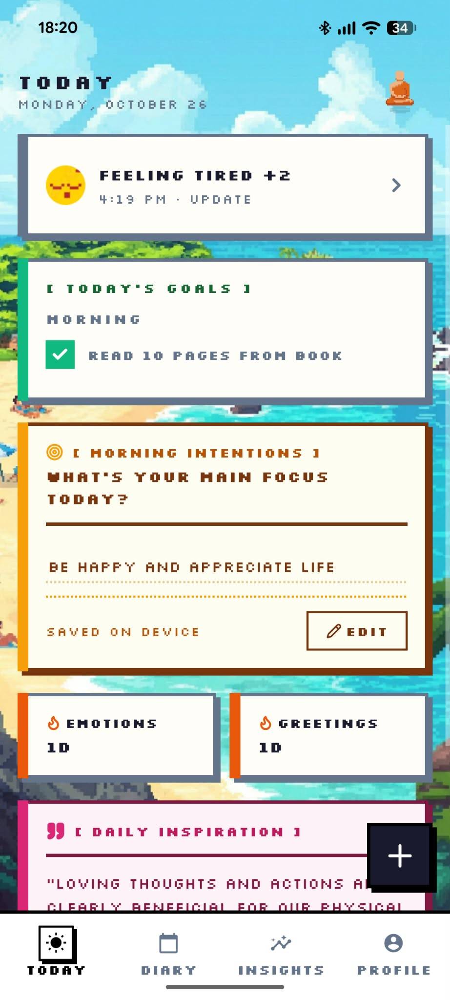
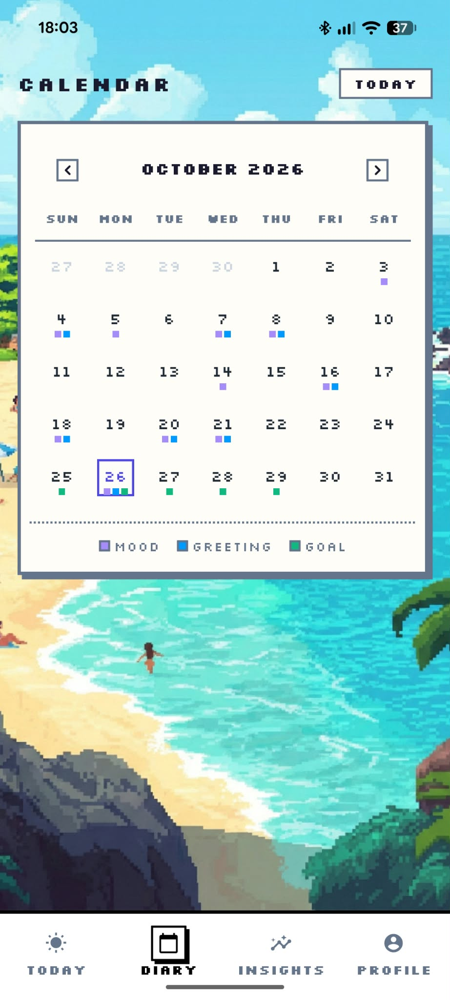
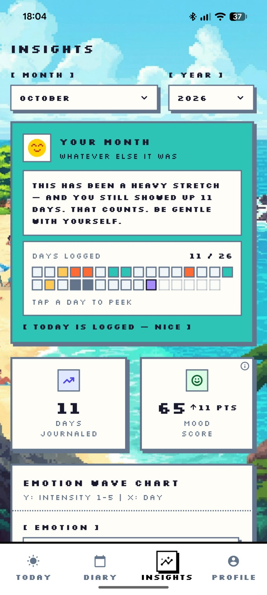
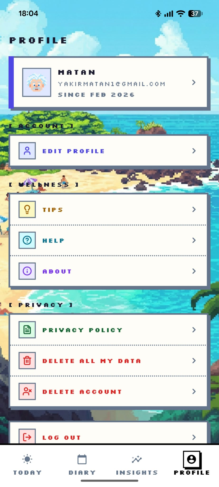

# Mindfulness

A pixel-art mobile app for logging how you feel and building small wellbeing habits.

Mindfulness is a mobile app to log how you feel each day, see your patterns over time, and get help improving your wellbeing. You can use it as a guest (data stays on your device) or sign in with an account (data is stored in Firestore).

<p align="center">
  
  
  
</p>

## Features

- Check in with one or more of 9 emotions and an intensity scale, then add reflection notes.
- Keep gratitude notes ("greetings").
- Set a morning intention, your main focus for the day.
- Diary calendar showing your entries, greetings and goal progress by day.
- Insights: emotion breakdown, emotion waves over time and summary cards.
- Daily streaks for check-ins and gratitude notes.
- Goals with flexible lengths (days, weeks, months or an end date), a weekday or picked-dates schedule, and pause/resume.
- Tips, an in-app help page and a guided 4-7-8 breathing exercise.
- Daily quote on the Today screen.
- Guest mode, with automatic migration of guest data into your account when you sign in.
- Profile editing, delete-all-data and delete-account.

## Screens

### Today
The home tab. Your latest check-in sits at the top (tap it to update it). Below it you'll find today's goals with a tick box, a morning intention (your main focus for the day, saved on the device), your emotion and gratitude streaks, and a daily inspiration quote. The round **+** button opens quick actions for emotions, goals and gratitude notes, and the monk in the corner opens the breathing exercise.


### Check In
Pick how you feel from the 9 emotions and rate the intensity.

<!-- SCREENSHOT: Check In screen with some emotions selected -> docs/screenshots/check-in.png -->
<!--  -->

### Reflection
Write notes about your check-in and save the entry. Your draft is kept if you go back.

<!-- SCREENSHOT: Reflection screen -> docs/screenshots/reflection.png -->
<!--  -->

### Diary
A monthly calendar of your history. Each day shows small colored squares: purple for a mood entry, blue for a gratitude greeting and green for a goal. Use the arrows to change month, tap **Today** to jump back, and tap any day to open its details.


### Insights
Pick a month and year to see how it went. A short, gentle message summarizes the month, and a grid shows which days you logged (tap a day to peek). Summary cards show the days you journaled and a mood score with its change from the previous month, followed by the emotion wave chart (intensity 1-5 per day). Further down are the emotion breakdown and goal progress.


### Profile
Your profile card (avatar, name, email, member since) opens profile editing. Below are Tips and Help under Wellness, and under Privacy you can delete all your data or delete your account. You can also log out.



### Goals
Opened from the Today screen's quick-action button. List your goals, pause, resume or delete them, and create or edit a goal with its length and schedule. You tick a goal off for the day from the goals card on Today.

<!-- SCREENSHOT: Goals screen -> docs/screenshots/goals.png -->
<!--  -->

<!-- SCREENSHOT: Goal form (new goal) -> docs/screenshots/goal-form.png -->
<!--  -->

### Breathe
A guided 4-7-8 breathing exercise with audio and haptic cues.

<!-- SCREENSHOT: Breathe screen mid-session -> docs/screenshots/breathe.png -->
<!--  -->

### Tips and Help
Short wellbeing tips and an in-app help page. Both are static content.

<!-- SCREENSHOT: Tips screen -> docs/screenshots/tips.png -->
<!--  -->

## Tech stack

- **App:** Expo and React Native, React Navigation, TanStack Query (cache persisted to AsyncStorage), axios, zod.
- **Backend:** Node.js and Express 5, deployed on Render.
- **Auth and data:** Firebase Authentication and Firestore (the server uses Firebase Admin).
- **Shared code:** zod schemas, types and pure logic (streaks, goal schedules and progress) in `shared/`, used by both the app and the server.

## Project structure

```
src/      The Expo / React Native app (screens, controllers, hooks, services, components)
server/   Express API (routes, controllers, services, repositories)
shared/   Types, zod schemas and pure logic used by both app and server
assets/   Images, icons and fonts
docs/     Notes and README screenshots
scripts/  Helper scripts (for example avatar generation)
```

## Getting started

### Prerequisites

- Node.js 22.13 or newer (the server requires `>=22.13 <23`).
- Expo Go on your phone, or an Android or iOS emulator.
- A Firebase project with Authentication and Firestore enabled.

### Install

```bash
npm install
cd server && npm install
```

### Environment

**App:** create a `.env` file in the repo root (it is gitignored).

| Variable | Used by | What it is |
|---|---|---|
| `API_HOST` | app | Your computer's IP address on the local network. The app calls `http://<API_HOST>:3000` |
| `API_URL` | app | Optional full URL of a deployed API. If set, it wins over `API_HOST` |
| `FIREBASE_API_KEY` | app | Firebase web app config |
| `FIREBASE_AUTH_DOMAIN` | app | Firebase web app config |
| `FIREBASE_PROJECT_ID` | app | Firebase web app config |
| `FIREBASE_STORAGE_BUCKET` | app | Firebase web app config |
| `FIREBASE_MESSAGING_SENDER_ID` | app | Firebase web app config |
| `FIREBASE_APP_ID` | app | Firebase web app config |

```
API_HOST=<your-computer-ip>
FIREBASE_API_KEY=<from your Firebase project settings>
# ...the other five FIREBASE_* values
```

**Server:** it needs a Firebase service account key (Firebase Console, Project settings, Service accounts, Generate new private key).

| Variable | Used by | What it is |
|---|---|---|
| `GOOGLE_APPLICATION_CREDENTIALS` | server | Path to the service account key file. Required in production |
| `FIREBASE_SERVICE_ACCOUNT_PATH` | server | Dev only: path to the key file if you don't use the default |
| `PORT` | server | Port to listen on (default `3000`) |
| `CORS_ORIGIN` | server | Allowed origin (default `*`) |
| `TRUST_PROXY` | server | Set to `true` when running behind a proxy such as Render |
| `NODE_ENV` | server | `production` on the deployed server |

In development, if `GOOGLE_APPLICATION_CREDENTIALS` is not set, the server reads `server/service-account.json`. The key file and `.env` files are gitignored. Never commit them.

### Run the server

```bash
cd server
npm run dev
```

### Run the app

```bash
npx expo start --tunnel
```

Use `--tunnel` so your phone can reach the dev server. After changing `.env`, restart with `npx expo start --tunnel --clear`.

## Tests

The only automated test covers the streak logic:

```bash
cd server
npm run test:streak
```

## Deployment

- **API:** deployed to Render with the `render.yaml` blueprint. There is no root directory, because the server compiles `shared/`. The build runs `npm ci --prefix server --include=dev && npm run build --prefix server`, and the service starts with `node server/dist/server/src/index.js`.
- **Health check:** Render pings `/healthz`, which always returns 200 and does not touch Firestore.
- **Credentials:** the Firebase service account key is added as a Render secret file named `serviceAccount.json`. `GOOGLE_APPLICATION_CREDENTIALS` points to it.
- **Mobile app:** built with EAS using the profiles in `eas.json` (development, preview, production). The preview and production profiles use EAS environments, so the Firebase values (and `API_URL`) must be set there, because `.env` is not uploaded to EAS.
